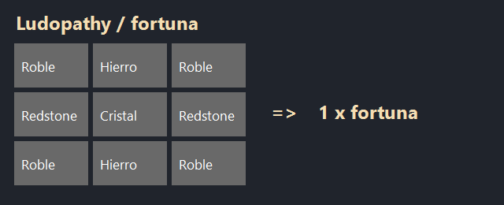
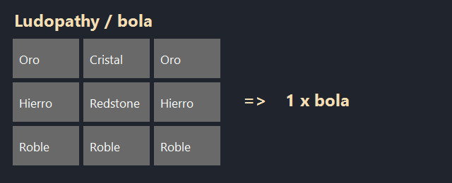

# Ludopathy Roulette

Dos máquinas físicas para Logitanos: rueda vertical con aguja y ruleta horizontal con bola. Premios, probabilidades y castigos configurables desde una puerta lateral protegida. El servidor decide resultados y cobros; los clientes dibujan la misma trayectoria.

## Versiones

| Componente | Versión de compilación |
|---|---|
| Mod | 1.0.0 |
| Minecraft | 26.3 |
| Fabric Loader | ≥ 0.20.1 |
| Fabric API | 0.165.0+26.3 |
| Java | 25 |

**Necesario en servidor y clientes.** El canal `view_v1` permite rechazar clientes sin el protocolo. Esta entrega se ha compilado y verificado con pruebas automatizadas sin instalar ni ejecutar Minecraft. Las pruebas multijugador, visuales y de aplicación de mixins en juego quedan pendientes: consultar [VALIDACION.md](VALIDACION.md).

## Archivos y compilación

Desde PowerShell, en esta carpeta:

```powershell
.\compilar.ps1 -Offline
```

`-Offline` utiliza las dependencias ya cacheadas. Sin ese parámetro Gradle puede resolver dependencias de compilación; el script nunca instala un cliente, arranca el juego ni copia archivos a una carpeta de juego. No ejecuta `runClient`, `runServer` ni descarga assets del juego para probar.

La entrega queda en `../../jar/LudopathyRoulette/`:

- `ludopathyroulette-1.0.0.jar`: mod compilado.

En `/jar` se copia únicamente el JAR instalable. Las fuentes compiladas quedan en `build/libs/`; la documentación y los informes permanecen en el proyecto.

Cuando se quiera utilizar en otra máquina con Minecraft, se instala el JAR normal junto a Fabric API en cliente y servidor. Esa instalación no forma parte de este trabajo.

## Conseguir los objetos

Pestaña creativa **Ludopathy Roulette** y recetas siguientes. Craftear una máquina no concede permiso de administración. Una caja nueva permanece sin publicar hasta configurarla y guardar.

| Id | Objeto |
|---|---|
| `ludopathyroulette:fortuna` | Ruleta de la Fortuna |
| `ludopathyroulette:bola` | Ruleta de Casino |

### Ruleta de la Fortuna



**Materiales necesarios:** 4 × tablones de roble, 2 × lingote de hierro, 2 × redstone y 1 × cristal. **Resultado:** 1 Ruleta de la Fortuna. Colocar como en la imagen.

### Ruleta de Casino



**Materiales necesarios:** 3 × tablones de roble, 2 × lingote de hierro, 2 × lingote de oro, 1 × redstone y 1 × cristal. **Resultado:** 1 Ruleta de Casino.

Madera de robles; hierro, oro y redstone mediante minería vanilla; cristal fundiendo arena. El mod no añade menas ni generación de mundo. Las imágenes se generan leyendo los JSON de recetas con `tools/generate_assets.ps1`, sin recursos de una instalación del juego.

## Configurar una máquina

1. Colocar el bloque mirando hacia la cara frontal deseada. Admite cuatro orientaciones.
2. Staff abre la puerta lateral derecha o usa `/ludopathyroulette editar` mirando el bloque a menos de 8 bloques.
3. **General:** nombre, niveles de XP, gratuidad de operador, pausa, anuncio y objeto de precio.
4. **Casillas:** seleccionar con flechas; añadir/quitar, elegir categoría, editar peso y aplicar. Hay 2–12 casillas. La proporción del sector coincide con su peso.
5. **Muestras:** seleccionar destino y pulsar un objeto del inventario. Se copia la plantilla en servidor; el original permanece en el inventario. El icono muestra el objeto y su tooltip.
6. **Acciones:** para una casilla `PUNISH`, configurar hasta tres acciones y sus muestras independientes. El factor `200` significa ×2. No se permite repetir tipo. Muerte y nada son exclusivos.
7. **Reparto:** alternativa de porcentaje; separar todas las cifras por `;`, por ejemplo `1;24;25;50`. Deben sumar 100. Admite coma o punto decimal. La conversión usa enteros y restos mayores.
8. **Probar:** demostración de la trayectoria sin cobro ni consecuencias. **Guardar y publicar** valida y publica todo. Un reparto con daño letal exige escribir el nombre exacto de la máquina en General.

El primer borrador contiene diamante 1 %, 3 panes 24 %, pepita de hierro 25 % y «nada» 50 %, a cambio de 1 lingote de oro (el precio es configurable: cualquier objeto, como diamante u oro, y/o niveles de XP). Está sin publicar. Cambiarlo antes de abrir al público si no encaja con el balance del servidor.

**Economía:** premios ilimitados generados desde plantillas autorizadas. El precio se consume; no va a un propietario. Borrar una muestra no devuelve objetos. No existe stock finito ni inventario de recaudación.

Dos administradores editan borradores separados. Si alguien guarda primero, el otro recibe conflicto y debe recargar. Una tirada activa conserva configuración anterior. Cerrar con cambios exige confirmar el descarte. Las máquinas conservan configuración en el registro del mundo y no en una plantilla editable del cliente.

## Jugar

Clic derecho en pantalla, rueda o cuerpo. Ver precio personal, probabilidades y consecuencias. Fortuna admite arrastre circular o botón; Casino usa botón. La fuerza cambia la duración, nunca las probabilidades. Precios de objetos requieren mismo tipo y componentes, y se cobran desde los 36 slots de inventario/barra, sin mano secundaria, armadura ni contenido anidado.

Puede cobrarse objeto, niveles de XP o ambos. Se descuentan niveles conservando el comportamiento vanilla de `giveExperienceLevels`; no son puntos de experiencia. Si falta cualquier componente, no se consume ninguno. Una tirada por máquina y una obligación bloqueante por jugador. No hay giro automático ni cola que cobre por adelantado.

- Fortuna: 90–180 ticks. Casino: 140–200 ticks. A 20 TPS corresponden a 4,5–9 s y 7–10 s; con TPS bajos se alargan.
- Un resultado raro ocupa un arco pequeño real; la lista muestra su porcentaje exacto redondeado, o `<0,01 %`.
- Cerrar o desconectar no cancela ni vuelve a sortear.
- Sin espacio, los objetos permanecen en buzón. Se intenta entrega automática al resolver/conectar; también mediante **Recoger** o comando.
- Historial local de las últimas 20 tiradas por máquina, con límite de 128 máquinas recientes. No es una prueba del cobro ni un registro persistente.
- Audio en tres niveles y movimiento reducido se guardan en `config/ludopathyroulette-client.json`. Teclado y botón permiten jugar sin arrastrar.
- Con una escala GUI demasiado grande, el editor solicita reducirla o ampliar ventana; la edición necesita al menos 412×240 píxeles lógicos de ventana.

## Castigos

| Acción | Comportamiento |
|---|---|
| `GIVE_ITEM` | Copia el objeto de su muestra |
| `EFFECT` | Lee la poción/flecha y aplica efectos al perdedor, sin entregar envase ni generar nube |
| `SPAWN` | Invoca hasta 3 criaturas permitidas; desactivado por defecto |
| `SURCHARGE` | Precio futuro de esa identidad ×1,5–×10 durante 1–5 tiradas |
| `KILL` | Intento de daño letal, mediante fuente propia; tótems y cancelaciones pueden impedir muerte |
| `NOTHING` | Ninguna consecuencia |

Efectos: lista permitida, hasta 8, duración ≤120 s, amplificador ≤4 (nivel V). Los instantáneos se rechazan. El recargo persiste al desconectar: multiplicadores se acumulan hasta ×10 y los usos se combinan tomando el máximo, hasta 5. Se redondea hacia arriba cada componente del precio. Un rechazo no consume usos.

Daño, efectos y recargo pendientes avisan durante 100 ticks jugables al volver/reaparecer. Una invocación diferida exige volver junto a la máquina original; bloquea nuevas tiradas hasta resolver. Deshabilitar la capacidad u origen desaparecido produce omisión registrada, sin sustituir castigo. Acciones de un plan tienen muestras separadas.

Al habilitar `SPAWN`, aceptar que la IA vanilla puede afectar a espectadores y bloques según sus reglas. La integración con protecciones de otros mods no está validada: mantener desactivado hasta comprobarla. Se usa comprobación vanilla de interacción, colisiones, borde del mundo y chunks cargados, con hasta 32 candidatos por criatura. No se copia NBT del huevo. Las criaturas marcadas no dan botín/XP gracias a mixins y caducan tras 2.400 ticks del reloj de su dimensión, retirándose al volver a tickear si estaban descargadas. No se mantienen chunks cargados.

## Permisos y comandos

Administración: operador nivel 2 o etiqueta de scoreboard `ludopathyroulette:admin`, de alcance **global**. Creativo solo si `allowCreative=true`. Gratuidad, política global y recuperación de incidencias requieren operador.

```mcfunction
/tag NombreDelJugador add ludopathyroulette:admin
/give @s ludopathyroulette:fortuna
/give @s ludopathyroulette:bola
```

| Comando tras `/ludopathyroulette` | Acceso |
|---|---|
| `ayuda`, `stats`, `pendientes`, `recoger` | Jugadores |
| `editar`, `probar`, `pausar`, `reanudar`, `retirar` | Staff |
| `recargar`, `diagnostico <spinId>` | Operador |
| `config [opcion valor]` | Operador o consola: consulta o guarda la configuración global |
| `resolver <spinId> confirmar` | Operador: da por resuelta sin repetir acciones |
| `resolver <spinId> continuar` | Operador: reanuda acciones pendientes verificadas |

`probar` abre el editor; usar su botón Probar. `stats`, edición y retirada requieren mirar la máquina a ≤8 bloques. Retirar requiere inventario con hueco, editores cerrados y ninguna obligación vinculada. Devuelve un único bloque con referencia de identidad; no devuelve premios de muestra. Solo puede trasladarse dentro del mismo mundo y con su registro de datos. Una copia de creativo no reutiliza identidad ni estadísticas.

Las máquinas son resistentes a explosiones, inamovibles por pistones y no se rompen normalmente: usar retirada autorizada. Comandos externos de modificación de mundo no están bloqueados; las operaciones aceptadas sobreviven en su registro.

## Política y recuperación

El primer arranque crea una única configuración de servidor, `config/ludopathyroulette.json`, con los valores predeterminados. No necesita plantillas ni archivos adicionales por máquina. Los ajustes específicos se realizan por comandos de operador, también desde consola, y se guardan en ese mismo archivo:

```mcfunction
/ludopathyroulette config
/ludopathyroulette config enableSpawn true
/ludopathyroulette config enableKill false
/ludopathyroulette config maxPending 64
/ludopathyroulette config allowedEntities minecraft:zombie,minecraft:spider
/ludopathyroulette config allowedEffects ninguno
```

`config` sin argumentos muestra los valores actuales; el autocompletado ofrece las opciones disponibles. Booleanos: `allowCreative`, `requireSneak`, `allowFree`, `enableSpawn`, `enableKill`; límites: `maxOperations` (1–4096), `maxPending` (1–1024); listas: `allowedEntities`, `allowedEffects` (identificadores separados por comas, o `ninguno`). Los cambios se validan y guardan antes de aplicarse; un error conserva la configuración vigente. `recargar` sigue disponible si se edita manualmente el único archivo. La configuración de cada máquina permanece en el registro existente del mundo y se abre con `editar`.

Datos del mundo en `data/ludopathyroulette/ledger.json`, escritura mediante temporal, sincronización y sustitución atómica. Copiar mundo, jugadores y este registro juntos en las copias de seguridad. Los logs auxiliares rotan entre dos archivos de hasta aproximadamente 8 MiB cada uno.

**Política ante caída:** un arranque que detecta parada inesperada pone todas las operaciones no liquidadas en `REVIEW`. No vuelve a cobrar, entregar, dañar ni invocar automáticamente. El jugador afectado queda bloqueado hasta revisión. Tras verificar inventario, cobro y acciones con `diagnostico`, el operador elige confirmar o continuar. Los reembolsos verificados se realizan manualmente. No se promete una transacción atómica global entre ficheros vanilla y el diario.

Una parada normal solicita guardar jugadores y marca diario limpio; reanuda las obligaciones guardadas. Una caída o fallo de almacenamiento durante el guardado, restauraciones parciales, inventarios revertidos y cambios externos pueden exigir reconciliación manual. Operaciones ya liquidadas no se reejecutan, aunque una restauración ajena revierta el inventario. Fallar la escritura del diario bloquea nuevas tiradas.

Límites actuales: 4.096 máquinas registradas, 256 obligaciones globales y 128 por jugador configurables, últimas 2.048 operaciones liquidadas como historial técnico. Las configuraciones de todas las máquinas registradas residen en memoria, incluso descargadas; no se cargan sus chunks. No se ha medido todavía el coste de los límites máximos. Esta es una diferencia explícita respecto al objetivo inicial de residencia solo de máquinas activas.

## Desarrollo

`Model` valida configuración y serializa stacks con el códec de componentes del juego; `Service` controla sesiones, borradores, cobro, reloj y entrega; `Ledger` almacena identidades y operaciones; `Wire` limita payloads. `core/` contiene matemáticas y escritura atómica independientes del juego. `client/` separa pantallas, preferencias y renderer. Dos mixins acotados suprimen botín/XP y retiran criaturas marcadas al caducar.

`tools/generate_assets.ps1` regenera recursos e imágenes usando System.Drawing de Windows. Los archivos generados están incluidos y no son necesarios para compilar en Linux. Los textos de objetos, muerte y sonidos tienen `es_es`/`en_us`; las pantallas de esta primera entrega usan texto español. Ver [idea.md](idea.md) para el diseño y [VALIDACION.md](VALIDACION.md) para la cobertura real.
