# The Ball

Te comes un **bocata** (o un **durum**), te devuelve **papel de aluminio**, y con el papel fabricas una **bola**
que puedes agrandar, empujar, lanzar, recoger… y meter en una **portería**.

**Novedad 1.1 — El Trono y la Reina de Aluminio:** sienta tu bola en un **trono**, agrándala entre todo el servidor
hasta las 2000 hojas y cada hoja te dará **experiencia** (mucha más al final). Por el camino caen comida y la
**armadura del Rey del Aluminio**; al coronar a la **Reina de Aluminio** quienes más aportaron reciben la **Corona** y
el **Cetro**… y con los dos, el poder definitivo: **¡DIOS DEL ALUMINIO!** Ver [El Trono y la Reina](#el-trono-y-la-reina-de-aluminio).

## Versiones

| Requisito | Versión |
|---|---|
| **Minecraft** | **26.3** (solo esta versión) |
| **Fabric Loader** | **0.20.1** o superior |
| **Fabric API** | **0.165.0+26.3** (la de 26.3; cualquiera de esa versión vale) |
| **Java** | **25** o superior |
| Versión del mod | `1.1.0` · mod id `theball` · Licencia MIT |

---

## Instalación

Necesitas **un solo `.jar`** (`theball-1.1.0.jar`) y [Fabric API](https://modrinth.com/mod/fabric-api) para Minecraft 26.3.

### Servidor

1. Servidor **Fabric** (Loader ≥ 0.20.1) para **Minecraft 26.3** con **Java 25** (instalador: <https://fabricmc.net/use/server/>).
2. Mete en `mods/` del servidor `theball-1.1.0.jar` y Fabric API.
3. Arranca el servidor. La primera vez se crea `config/theball.json` con los valores de balance (ver [Configuración](#configuración)).

> **Actualizar desde la 1.0:** basta con cambiar el `.jar`. Las bolas antiguas siguen igual (empiezan sin aportes
> ni premios dados).

### Jugadores

Cada jugador necesita **el mismo `.jar` + Fabric API** en su carpeta `mods/`. La bola es una entidad nueva con render
propio y los clientes vanilla no la pueden mostrar. No hay versión "solo servidor".

### Conseguir el `.jar`

- Ya compilado en `jar/TheBall/` del repo, o
- Compilarlo tú (JDK 25): desde esta carpeta, `./gradlew build` (Windows: `gradlew.bat build`).
  Sale en `build/libs/theball-1.1.0.jar` (ignora el `-sources`). Para probar en el juego: `./gradlew runClient`.

---

## Crafteos

Cada receta lleva su imagen y, debajo, **Materiales necesarios** (lo que gastas) y **Resultado** (lo que sale).
**Carne** = *cualquiera* de chuleta de cerdo, filete, cordero, pollo o conejo **cocinados**.
Las recetas "sin forma" se pueden colocar en cualquier hueco de la mesa.

### Comida

#### Bocata

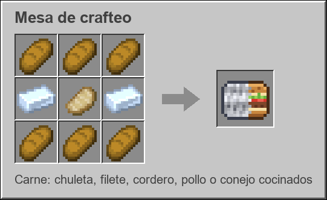

**Materiales necesarios**
- 6 × Pan
- 2 × Lingote de aluminio
- 1 × Carne cocinada

**Resultado:** 1 Bocata. Al comerlo devuelve **1 papel de aluminio** (nutrición 8, se puede comer con el hambre llena).

#### Durum

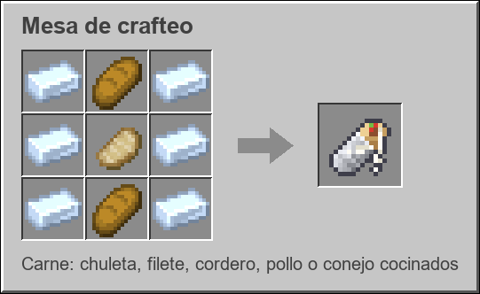

**Materiales necesarios**
- 6 × Lingote de aluminio
- 2 × Pan
- 1 × Carne cocinada

**Resultado:** 1 Durum. Al comerlo devuelve **3 papeles de aluminio** (nutrición 10, se puede comer con el hambre llena).

> Si no te cabe el papel en el inventario, cae al suelo.

### Aluminio

#### Lingote de aluminio (fundir)

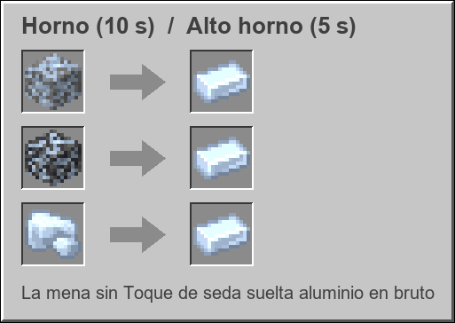

**Materiales necesarios**
- 1 × Mena de aluminio, Mena de aluminio de pizarra **o** Aluminio en bruto (cualquiera de las tres)
- Combustible (en un horno o un alto horno)

**Resultado:** 1 Lingote de aluminio (0.7 xp). Horno: 10 s · Alto horno: 5 s.

#### Papel de aluminio (sin forma)

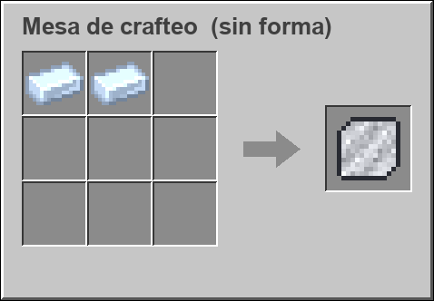

**Materiales necesarios**
- 2 × Lingote de aluminio

**Resultado:** 1 Papel de aluminio.

#### Bloque de aluminio

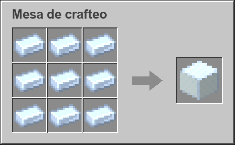

**Materiales necesarios**
- 9 × Lingote de aluminio

**Resultado:** 1 Bloque de aluminio.

#### Bloque de aluminio → 9 lingotes (sin forma)

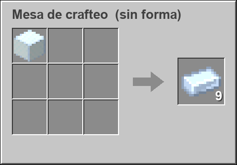

**Materiales necesarios**
- 1 × Bloque de aluminio

**Resultado:** 9 Lingotes de aluminio.

#### Bloque de aluminio → 5 papeles (cortapiedras)

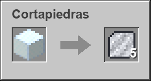

**Materiales necesarios**
- 1 × Bloque de aluminio (en la cortapiedras)

**Resultado:** 5 Papeles de aluminio. Es más barato que hacerlo con lingotes: 5 papeles por 9 lingotes, en lugar de 4,5.

### Bola

#### Bola de aluminio (sin forma)

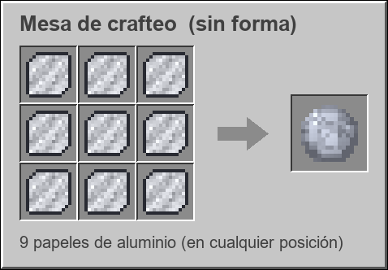

**Materiales necesarios**
- 9 × Papel de aluminio (en cualquier posición de la mesa)

**Resultado:** 1 Bola de aluminio de 9 hojas.

> En materiales en bruto son 18 lingotes de aluminio (9 papeles × 2 lingotes), o 2 bloques de aluminio en la cortapiedras (10 papeles).

#### Fusionar bolas (yunque)

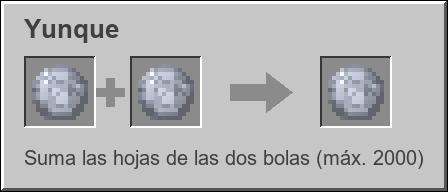

**Materiales necesarios**
- 2 × Bola de aluminio (cualquier tamaño)
- Niveles de experiencia: `2 + hojas/50` (máximo 39)

**Resultado:** 1 Bola de aluminio con las hojas de las dos sumadas (máximo 2000).

### Fútbol

#### Portería de fútbol

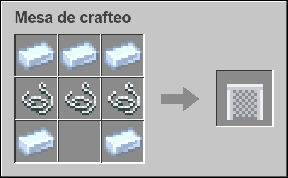

**Materiales necesarios**
- 5 × Lingote de aluminio
- 3 × Hilo

**Resultado:** 1 Portería de fútbol.

#### Cono (sin forma)

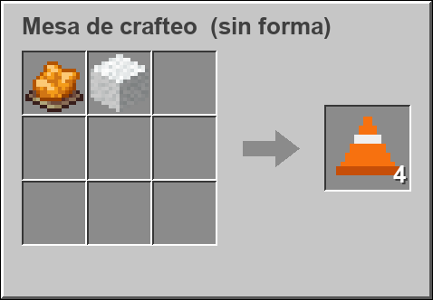

**Materiales necesarios**
- 1 × Tinte naranja
- 1 × Lana blanca

**Resultado:** 4 Conos. Con un solo tinte y una lana tienes 4 conos de entrenamiento.

### Realeza

#### Trono de aluminio

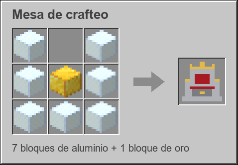

**Materiales necesarios**
- 7 × Bloque de aluminio (63 lingotes)
- 1 × Bloque de oro

**Resultado:** 1 Trono de aluminio. Mira hacia ti al colocarlo, se rompe con pico de piedra o mejor, se suelta a sí
mismo y aguanta las explosiones como la obsidiana.

> La armadura del Rey, la Corona, el Cetro y la Medalla **no se fabrican**: son premios del trono
> (ver [Recompensas](#recompensas)).

---

## Aluminio: dónde encontrarlo

- **Mena de aluminio** y **Mena de aluminio de pizarra**, en todos los biomas del Overworld, con una frecuencia
  parecida a la del hierro (se generan en tres capas: alta Y 80–384, media Y −24–56 y toda la altura hasta Y 72 en
  vetas pequeñas).
- **Mundos ya existentes:** la generación normal solo actúa en chunks nuevos. Para los antiguos, la primera vez que
  se carga un chunk sin aluminio el mod le añade las mismas vetas que el hierro, **solo en roca sin tocar** (sin aire ni
  líquidos alrededor: nunca en cuevas, galerías ni zonas recorridas) y una sola vez por chunk. `/theball retrogen` lo
  fuerza en el chunk donde estás, y `/theball retrogen stats` cuenta el aluminio de los chunks cargados a tu alrededor.
  Se apaga con `world.retrogen = false` en `config/theball.json`.
- Se mina con **pico de piedra** o mejor.
- Suelta **Aluminio en bruto** (afecta Fortuna). Con **Toque de seda** suelta la mena.

---

## Cómo se juega con la bola

### Conseguir papel
Cómete bocatas y durums (el papel vuelve al inventario) o fabrícalo con lingotes. Ver [Crafteos](#crafteos).

### Soltar, recoger y lanzar
- **Soltar**: un toque rápido de click derecho con la bola en la mano la deja delante de ti.
- **Recoger**: click derecho sobre la bola **sin papel de aluminio en la mano**. Se guarda con todas sus hojas.
- **Lanzar**: mantén click derecho con la bola en la mano para cargar y suelta. Cuanto más cargas, más fuerte sale.
  Cuanto más grande es, más cuesta lanzarla.

### Agrandar
Click derecho sobre la bola con **papel de aluminio** en la mano: +1 hoja. En creativo no se gasta.

**Cada hoja nueva cuesta siempre 1 papel de aluminio**, sea cual sea el tamaño de la bola.

Para ahorrar papel, **funde varias bolas en el yunque** (el papel ya invertido se suma).

### Tamaño

Hasta 500 hojas crece despacio (el volumen es proporcional al papel); a partir de ahí, más rápido hasta 8 bloques:

| Hojas | Diámetro |
|---|---|
| 9 | 0.12 bloques |
| 100 | 0.26 |
| 500 | 0.46 |
| 2000 (máx.) | 8 bloques |

Las bolas de menos de 1 bloque no son sólidas (se empujan al pasar por encima); a partir de ≈ 610 hojas ya tienen colisión.

### Moverla
- **Pégale** y sale despedida en dirección contraria. Cuanto más grande, menos sale.
- Si **caminas contra ella**, también la empujas.
- Tiene gravedad, rozamiento y rueda de forma visible. Es inmune a lava, vacío, etc.

### Portería y conos
- La **portería de fútbol 11** mide 7,32 m × 2,44 m con 2 m de fondo. Se coloca con click derecho sobre el suelo y
  la boca mira hacia ti.
- Si la bola entra por la boca y pasa la línea: **¡¡GOOOL!!** (mensaje en la action bar, fuegos artificiales y sonido).
- Se puede atravesar la red a pie. **Pégale al larguero** para recogerla; si hay una bola dentro, el golpe va a la bola.
  Para girarla, recógela y vuelve a colocarla.
- Los **conos** son bloques de entrenamiento para hacer eslálom.

---

## El Trono y la Reina de Aluminio

Hacer una Reina de 2000 hojas cuesta **1.991 papeles** (≈ 3.600 lingotes): es un **esfuerzo de todo el servidor**.
El trono convierte ese esfuerzo en experiencia y premios, sin que nadie se lo lleve todo por poner el último papel.

### Sentar la bola

| Acción | Qué pasa |
|---|---|
| Click derecho **con una bola** sobre el trono vacío | La bola se **sienta**: queda quieta sobre el asiento, con corona, y crece hacia arriba |
| Click derecho **con papel** sobre la bola (o el trono) | +1 hoja, igual que siempre (mismo coste). **Da XP** a quien pone el papel |
| **Mantener** click derecho con papel | Alimenta en tanda (una hoja cada 4 ticks) |
| Click derecho con la **mano vacía** | Estado en la barra superior (la misma que sale al mirar a la Reina): hojas, siguiente hito y **tu aporte en %**. Si tenías premios pendientes, te los da |
| **Shift + click** con la mano vacía | Retira la bola: vuelve al inventario con hojas, aportes y premios dados |
| Golpear la bola sentada | No se mueve (solo suena) |
| Romper el trono | La bola se libera con física normal (no se convierte en item: puede medir 8 bloques) |

- **Hace falta sitio**: antes de cada hoja se comprueba que la bola quepa (hasta **8 × 8 × 8** sobre el asiento). Si
  no cabe, no se gasta papel, te avisa del hueco necesario y **dibuja con partículas rojas el cubo** que hace falta.
- Al crecer, quien esté dentro de la bola acaba **encima**: te puedes subir a una Reina de 8 bloques.
- **Corona sobre la bola**: crece con ella y cambia con las hojas: plata (0–499) · +joya azul (500) · +roja (1000) ·
  +verde (1500) · **diamantes en las puntas** al coronarla (2000).
- **Barra de la Reina** (la dibuja el cliente, ligera, con fundido y relleno suave) «Reina de Aluminio · 1247 / 2000 hojas · Siguiente hito: 1300 · Tu aporte: 3,2 %» (con 20 marcas,
  una por hito): una por jugador, sin iconos, y **solo aparece mientras miras a la Reina** (a menos de 24 bloques).
- **Ranking del tributo**: un holograma sobre la bola con los 3 que más papel han puesto.
- Cada 100 hojas, fanfarria (chispas, campana y mensaje); en 250/500/1000/1500, cohetes de verdad.
- Solo una bola por trono; puede haber varios tronos (y varias Reinas) en el servidor.

### Experiencia

El XP se paga **por cada hoja añadida en el trono, a quien pone ese papel**, al instante: no hay nada que "reclamar".
**Cada hoja da siempre lo mismo** (`xp.per_sheet`, 1 XP por defecto): la hoja 10 y la 2000 valen igual, sin multiplicadores.
El plus grande es el **bonus de hito**: al completar cada 100 hojas, quien pone la hoja que lo completa cobra el bonus de
esa tabla de golpe (el primero sube **1,5 niveles** y el último **30**). Fuera del trono y en creativo no se paga XP.

| Hito | Hojas | Bonus del hito (XP) | Niveles que sube* | Nivel al terminar* |
|---|---|---|---|---|
| 1 | 0–100 | 12 | +1,5 | 1,5 |
| 2 | 100–200 | 18 | +1,7 | 3,2 |
| 3 | 200–300 | 26 | +1,9 | 5,0 |
| 4 | 300–400 | 37 | +2,1 | 7,1 |
| 5 | 400–500 | 51 | +2,3 | 9,4 |
| 6 | 500–600 | 69 | +2,5 | 11,9 |
| 7 | 600–700 | 92 | +2,8 | 14,7 |
| 8 | 700–800 | 129 | +3,1 | 17,9 |
| 9 | 800–900 | 201 | +3,5 | 21,3 |
| 10 | 900–1000 | 294 | +3,9 | 25,2 |
| 11 | 1000–1100 | 415 | +4,3 | 29,5 |
| 12 | 1100–1200 | 598 | +4,8 | 34,3 |
| 13 | 1200–1300 | 904 | +5,3 | 39,6 |
| 14 | 1300–1400 | 1.303 | +5,9 | 45,5 |
| 15 | 1400–1500 | 1.815 | +6,6 | 52,1 |
| 16 | 1500–1600 | 2.472 | +7,3 | 59,4 |
| 17 | 1600–1700 | 3.307 | +8,1 | 67,5 |
| 18 | 1700–1800 | 4.367 | +9,0 | 76,5 |
| 19 | 1800–1900 | **5.708** | **+10,0** | 86,5 |
| 20 | 1900–2000 | **22.523** | **+30,0** | 116,5 |

\* Si un solo jugador pusiera todas las hojas empezando en nivel 0. El XP es fijo; los niveles dependen del nivel con
el que empieces. La tabla solo cuenta el bonus de hito (las hojas suman 1 XP cada una más). Total de bonus: ≈ 44.300 XP.

### Recompensas

| Hojas (con la bola sentada) | Premio |
|---|---|
| 250 | Pack de comida: 8 bocatas + 4 durums |
| 500 | Botas del Rey del Aluminio |
| 1000 | Pantalones del Rey del Aluminio |
| 1500 | Peto del Rey del Aluminio |
| **2000** | **Coronación**: Corona de aluminio + Cetro del Rey de Aluminio |

- Comida, botas, pantalones y peto: los reciben los que han puesto **≥ 10 % del papel de una Reina** (≈ 199 papeles).
  Si **nadie** llega, se lo lleva **el que más ha puesto**.
- **Corona y Cetro: solo hay un Rey**, y se elige en el **Coronamiento** (ver abajo) entre los **3 primeros del ranking**.
  Es Rey el primero del ranking que haya puesto al menos el **10 %** de los últimos **350 papeles** (35); quien puso
  muchísimo y luego dejó de aportar cede la corona al siguiente. Si ninguno de los 3 llega, gana el que más puso en
  esos 350. (`final_stretch_sheets`, `min_final_stretch_percent` y `conclave_countdown_seconds` en `config/theball.json`.)
- Al coronar, **Medalla del tributo** para los 3 candidatos y para quien haya puesto **≥ 2 %** (≈ 40 papeles), con su
  nombre y sus papeles grabados.
- Los aportes se apuntan **siempre** que alguien pone papel (dentro o fuera del trono), viajan con la bola y se suman
  al fusionarla en el yunque. En creativo no cuentan.
- Cada premio se entrega **una sola vez por bola**, y solo si se cruza **con la bola sentada**: una bola que llega
  ya grande al trono **no cobra los hitos que dejó atrás** (solo se premia lo que crece desde ahí).
- ¿No estabas conectado? Tu premio te espera: **usa el trono con la mano vacía** y te lo da.

### El Coronamiento (2000 hojas)

1. **Aviso y cuenta atrás (10 min):** al llegar a 2000 hojas, la Reina deja de aceptar papel y no se puede retirar. Se
   avisa a todo el servidor con los **3 candidatos** (los 3 primeros del ranking). La cuenta atrás sale en la barra de
   acción de los que están cerca, con avisos en el chat (8:00, 5:00, 3:00, 2:00, 1:00, 0:30) y campanadas de 10 a 1.
2. **Ascensión:** los candidatos conectados (si falta alguien entra el siguiente del ranking) se teletransportan junto a
   la Reina y **suben en haces de luz**. Quedan quietos e **invulnerables** durante el juicio.
3. **Juicio:** un haz de luz recorre a los candidatos y se detiene en uno: **descartado** (el haz se rompe, título con su
   nombre y baja con caída lenta). Se repite hasta que queda uno.
4. **Coronación:** un anillo de luz baja a la cabeza del elegido, destello, **la corona de la Reina se vuelve de oro**,
   cohetes y tres haces al cielo; título «nuevo Rey del Aluminio». Se entregan los premios y todos quedan libres.

Si un candidato se desconecta durante el juicio queda descartado. Si el servidor se reinicia **en la cuenta atrás**,
sigue donde estaba; si es **en pleno juicio**, se corona directamente por la regla (premios pendientes en el trono).
Después la Reina coronada **brilla con un haz de luz permanente** mientras esté en su trono.

### Armadura del Rey del Aluminio

| Pieza | Defensa | Durabilidad |
|---|---|---|
| Corona de aluminio (casco) | 3 | 520 |
| Peto del Rey del Aluminio | 8 | 640 |
| Pantalones del Rey del Aluminio | 6 | 600 |
| Botas del Rey del Aluminio | 3 | 440 |

Dureza 3 y resistencia al empuje 0,05 por pieza, encantabilidad 25, rareza épica. **Ligera**: cada pieza suma
**+2,5 % de velocidad** (+10 % con las cuatro). Se repara con **lingotes de aluminio** en el yunque.
Con el **set completo** el cetro mejora (bolas rebotonas gratis).

### Poderes de la Corona

Basta con llevar la Corona puesta:

| Poder | Cómo | Qué hace |
|---|---|---|
| **Rebote** (pasivo) | — | Sin daño de caída. Si caes desde más de 3 bloques, **rebotas** (hasta 6 bloques). Agachado no rebotas |
| **Reflejo** (pasivo) | — | El **30 %** de los proyectiles que te alcanzan **vuelven a quien los lanzó** con un destello plateado |
| **Modo Bola** | **Doble toque de Shift** (quieto, sin pulsar W/A/S/D) | Te encoges dentro de una bola de aluminio y ruedas al doble de velocidad: **arrollas** a los enemigos (4 de daño y por los aires) y los proyectiles no te hacen nada. **Sin límite de tiempo ni espera**: otro doble toque de Shift (o quitarte la Corona) y sales. **Saltos grandes (≈ 4-5 bloques) y rebotes** como una pelota; la cámara pasa sola a tercera persona y se restaura al salir |
| **Decreto real** | Agachado + saltar | Onda que empuja a los enemigos a 8 bloques y los marca con brillo. Espera de 45 s |

### Cetro del Rey de Aluminio

No tiene durabilidad: su gasolina es el **papel de aluminio** de tu inventario. En creativo no gasta (pero sí espera).

| Cómo | Poder | Coste | Espera |
|---|---|---|---|
| Click derecho (toque) | **Bola rebotona**: bolita brillante que rebota 4 veces y hace 6 de daño en cada golpe | 1 papel (gratis con el set) | 0,4 s |
| Mantener click derecho | **Bola explosiva**: al soltar **con la carga completa** lanzas una bola que **explota con cualquier impacto** (suelo, pared, criatura o jugador; radio 4,5, 14 de daño, más que la rebotona; no rompe bloques). Si sueltas antes de completar la carga no se lanza nada y vuela hasta ~100 bloques sin frenarse. Si mantienes más de **1,5 s** empieza un **efecto de carga en la punta del cetro** (chispas que convergen, campanitas cada vez más agudas); con la carga completa la bola es más grande y más fuerte | 5 papeles | 2 s |
| Agachado + toque | **Embestida**: un impulso hacia donde miras que aparta (y hiere, 4 de daño) a quien esté en el camino. Sin daño de caída tras usarla | 2 papeles | 5 s |
| Agachado + mantener 3 s **con la Corona** | **¡DIOS DEL ALUMINIO!** | 50 papeles | 3 min |

Ningún poder daña a tu equipo ni a tus mascotas. Una bola sentada en un trono no se puede chutar.

### ¡Dios del aluminio! — La Ascensión de la Reina

1. **Carga (3 s)**: columna de luz, círculo mágico de chispas a tus pies, papeles de aluminio orbitando y una campana
   que sube de tono. Se cancela si te mueves más de 3 bloques, sueltas el botón o te dan un golpe fuerte (sin gastar
   papel).
2. **Ascensión**: destello, subes 3 bloques y aparece **un halo**: la corona de oro gigante girando sobre tu cabeza.
   El mensaje «¡DIOS DEL ALUMINIO!» lo ves solo tú, en la barra de acciones.
3. **El modo (20 s, por tiempo)**: flotas rodeado de **8 bolas de aluminio que giran en órbita** (un anillo plano y otro
   inclinado, con estela de chispas; son solo efecto). **No hay cargas**: durante los 20 s atacas todo lo que quieras.
   Las bolas golpean (3 de daño) a quien se acerque. Con el cetro:
   - **Volar**: **WASD** vuela rápido (16 bloques/s), **Espacio** sube y **Shift** baja.
   - **Click izquierdo**: **GOLPE AL SUELO**: te lanzas en picado, hecho una bola de luz, al bloque que apuntas (hasta
     48 bloques); el impacto (radio 6, 25 de daño) saca dos aros de onda expansiva, escombros y brasas, y **subes solo**
     a la altura de vuelo.
   - **Click derecho (toque)**: bola explosiva normal (la misma del cetro: 14 de daño, radio 4,5) desde una de las bolas.
   - **Click derecho mantenido** hasta completar la carga (efecto en la punta): **bola gigante** (radio 7, 30 de daño,
     trueno y brasas). Con **Shift** pulsado al soltar: **salva** de 3 bolas normales en abanico.
   Los segundos restantes salen en pantalla. La cámara pasa sola a tercera persona.
4. **Final**: al acabar el tiempo no pasa nada especial: **desciendes** con caída lenta, sin daño y sin rebote.

Durante la habilidad tienes Resistencia III. **No rompe bloques** (salvo que la config lo active) y no daña a aliados.
La espera de 3 min se guarda: sobrevive a desconectarte o a reiniciar el servidor.

### Logros

| Logro | Cómo |
|---|---|
| Su Majestad la Bola | Sienta una bola en un trono |
| Mecenas | Aporta 1000 papeles a una misma bola |
| ¡Larga vida a la Reina! | Presencia una coronación |
| ¡DIOS DEL ALUMINIO! *(oculto)* | Completa la Ascensión |

### Configuración

`config/theball.json` del servidor (se crea solo). Todo el balance está ahí: comprobación de espacio, alcance de la
barra de jefe, holograma, **XP por hoja** (`xp.per_sheet`) y **bonus de hito** (`xp.milestone_xp`), porcentajes de premio, `once_per_player` (cada jugador
solo puede recibir una vez la Corona y el Cetro), y daños, esperas y costes de cada poder (se pueden desactivar uno a
uno). Tras editarlo: `/theball reload`.

### Comandos (operadores)

| Comando | Qué hace |
|---|---|
| `/theball reload` | Recarga `config/theball.json` |
| `/theball reward <jugadores> <250\|500\|1000\|1500\|2000>` | Entrega a mano un premio del trono |
| `/theball cooldown reset <jugadores>` | Reinicia las esperas de la Corona y el Cetro |
| `/theball coronation skip` | (mirando a un trono) Salta la cuenta atrás del Coronamiento y empieza ya el juicio |
| `/theball coronation test` | (mirando a un trono) Prueba el espectáculo contigo como Rey y 2 aldeanos de candidatos; no entrega premios y la bola vuelve a como estaba |
| `/theball retrogen` | Rellena de aluminio (solo roca sin tocar) el chunk donde estás, para probar |
| `/theball retrogen stats` | Cuenta el aluminio de los chunks cargados a 8 chunks a la redonda |
| `/theball throne info` | (mirando a un trono) Hojas, aportes por jugador, premios dados y pendientes |
| `/theball throne setsheets <n>` | (mirando a un trono) Fija las hojas de la bola sentada (para probar) |

---

## Pestaña de creativo

**The Ball** contiene todo: bocata, durum, menas, portería, cono, bruto, lingote, bloque, papel, bolas de ejemplo
(9, 100, 500, 1000, 1500, 2000 hojas), trono, las cuatro piezas de la armadura del Rey, el cetro y la medalla.

## Ids

| Item / bloque / entidad | ID |
|---|---|
| Bocata | `theball:bocata` |
| Durum | `theball:durum` |
| Papel de aluminio | `theball:aluminum_foil` |
| Bola de aluminio (item y entidad) | `theball:aluminum_ball` |
| Lingote de aluminio | `theball:aluminum_ingot` |
| Aluminio en bruto | `theball:raw_aluminum` |
| Bloque de aluminio | `theball:aluminum_block` |
| Mena de aluminio | `theball:aluminum_ore` |
| Mena de aluminio de pizarra | `theball:deepslate_aluminum_ore` |
| Portería (item y entidad) | `theball:goal` |
| Cono | `theball:cone` |
| Trono de aluminio | `theball:throne` |
| Corona de aluminio | `theball:aluminum_crown` |
| Peto / Pantalones / Botas del Rey del Aluminio | `theball:aluminum_chestplate` / `theball:aluminum_leggings` / `theball:aluminum_boots` |
| Cetro del Rey de Aluminio | `theball:aluminum_scepter` |
| Medalla del tributo | `theball:tribute_medal` |
| Bola rebotona / Dios del aluminio (entidades) | `theball:foil_shot` / `theball:explosive_shot` |
| Componentes de la bola | `theball:sheets`, `theball:contributions`, `theball:rewards_given` |
| Material de armadura (equipo) | `theball:aluminum_king` |

Dar una bola de tamaño concreto: `/give @s theball:aluminum_ball[theball:sheets=100]`

Dar una Reina lista para coronar en cuanto se siente: `/give @s theball:aluminum_ball[theball:sheets=2000]`
(una bola así no tiene aportes, así que la coronación no da premios a nadie: para probarlos, `/theball reward`).

Idiomas: `es_es` y `en_us`.

---

## Para desarrolladores

```
src/main/java/com/theball/
  TheBallMod                     registros + eventos (tick de poderes, daño, muerte, cambio de dimensión, desconexión)
  config/TheBallConfig           config/theball.json (Gson, snake_case)
  registry/                      items, bloques, block entities, entidades, componentes, attachments, logros
  block/ThroneBlock, block/entity/ThroneBlockEntity   el trono (bola sentada + premios pendientes)
  throne/                        ThroneLogic (sentar, alimentar, espacio, barra de jefe, holograma), XpPayout,
                                 Rewards, Coronation, Fanfare, Tribute/Contributor (aportes que viajan con la bola)
  item/                          AluminumBallItem, KingArmor (material + velocidad), ScepterItem, TributeMedalItem...
  entity/                        AluminumBallEntity (física + trono), FoilShot, ExplosiveShot, PowerVisual
  power/                         CrownPowers, ScepterPowers, ExplosiveAbility (máquina de estados), FoilFuel, Allies
  command/TheBallCommands        /theball ...
  mixin/                         AnvilMenuMixin (fusión), EntityDeflectionMixin (Reflejo de la Corona)
src/client/java/com/theball/client/
  SphereMesh, CrownMesh          esfera y corona generadas por código (la corona de la Reina es siempre de oro; las joyas crecen con las hojas)
  *Renderer                      bola (+corona), portería, proyectiles, esfera del Modo Bola y halo
src/main/resources/              assets (lang, models, items, textures, equipment), data (recipe, loot_table,
                                 worldgen, advancement, tags)
tools/generate_textures.py       texturas de la 1.0 (python + Pillow)
tools/generate_king_textures.py  texturas de la 1.1: trono, corona, armadura (64×32), cetro, medalla
tools/generate_recipe_images.py  imágenes de crafteo de docs/recipes/ (usa el jar de Minecraft para las texturas vanilla)
plan_update.md                   diseño de la 1.1 (con lo que ha cambiado al implementarlo)
docs/CONTEXTO.md                 notas de diseño originales (algunas cifras han cambiado, esto manda)
```

Cosas que se cambian fácil:
- Tamaño máximo (`MAX_SHEETS`), fórmula de diámetro (`diameterFor`) y coste de papel (`foilCostFor`) en
  `AluminumBallEntity`.
- Rozamiento, rebotes y fuerza del golpe en `tick()` / `hurtServer()`.
- Carnes del bocata y durum, en `data/theball/recipe/bocata.json` y `durum.json`.
- Frecuencia del aluminio, en `data/theball/worldgen/placed_feature/`.
- **Todo el balance de la 1.1** (XP, premios, daños, esperas, costes): `config/theball.json`, sin recompilar.
- Umbrales y premios del trono: `Tribute.THRESHOLDS` y `Rewards.deliverBits`.
- Estadísticas de la armadura: `KingArmor.MATERIAL`.
- Fases y efectos del Dios del aluminio: `ExplosiveAbility`.

Cómo funcionan algunas piezas por dentro:
- La **bola sentada** es la misma entidad con un ancla (`Optional<BlockPos>` sincronizada): sin física, se recoloca
  cada tick sobre el asiento y comprueba cada segundo que su trono sigue ahí.
- El **Modo Bola** y el **halo** son una entidad visual (`PowerVisualEntity`, no se guarda) que el cliente dibuja en
  la posición interpolada del jugador; el encogimiento es el atributo vanilla `scale` (sin mixins de render).
- El **Reflejo** usa `Entity#deflection`, el mismo mecanismo con el que la Breeze desvía proyectiles.
- Las explosiones del Dios del aluminio son "a mano" (daño en radio solo a enemigos), por eso nunca hay fuego
  amigo ni bloques rotos; `explosive.break_blocks = true` añade una explosión vanilla.
